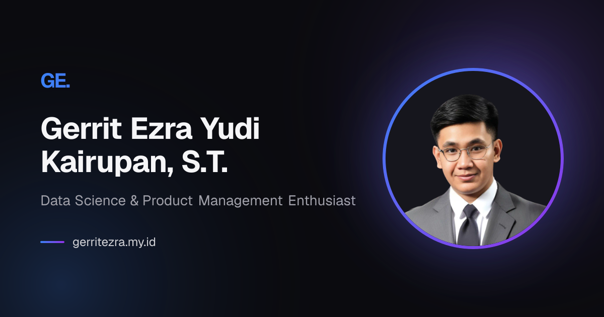

<div align="center">


<a href="https://gerritezra.my.id">
  
</a>

<p>
  <a href="https://gerritezra.my.id"></a>
  <a href="https://linkedin.com/in/gerritezra"></a>
  <a href="mailto:gerritezra.work@gmail.com"></a>
  <a href="assets/CV-Gerrit-Ezra-Yudi-Kairupan.pdf"></a>
</p>


</div>

<br/>

<div align="center">
  <a href="https://gerritezra.my.id">
    
  </a>
  <br/>
  <sub>🌐 <b><a href="https://gerritezra.my.id">gerritezra.my.id</a></b>: projects, certificates, and the full story. Click the card to visit.</sub>
</div>

<br/>

## 👋 About me

I'm **Gerrit**, a Bachelor of Engineering in Information Engineering from **Universitas Gadjah Mada** (cum laude) and a **Certified Associate Data Scientist (BNSP)**. I work where product management meets data: analytics, data science, and data engineering, aimed at real social impact.

```yaml
now:        Junior Expert of IT & Data Specialist @ Ministry of Public Works (BPIW)
building:   SIPro, the national infrastructure planning, programming & budgeting platform
studying:   Professional Engineer Program (Informatics) @ Universitas Indonesia · GPA 4.00
previously: Product QA Analyst, Automation (RPA & OCR) @ Bank Central Asia
interests:  [decision support systems, geospatial ML, MLOps, product strategy]
languages:  [Bahasa Indonesia (native), English (TOEFL iBT 87)]
```

## 🏆 Highlights

<table>
  <tr>
    <td align="center" width="16%"><h2>5</h2><sub>government apps integrated into SIPro via API</sub></td>
    <td align="center" width="16%"><h2>~22%</h2><sub>less task time from the UI design I validated with users</sub></td>
    <td align="center" width="16%"><h2>40+</h2><sub>RPA & OCR projects quality-assured at BCA</sub></td>
    <td align="center" width="16%"><h2>70%</h2><sub>faster road-data entry with Power Automate</sub></td>
    <td align="center" width="16%"><h2>Top 5</h2><sub>of 300+ at EISC 2026, presented at BRIN</sub></td>
    <td align="center" width="16%"><h2>Best</h2><sub>Student, Bank Mandiri Innovation Bootcamp</sub></td>
  </tr>
</table>

## 💼 Experience

| When | Role | Where |
|---|---|---|
| **Jun 2025 – now** | 🏗️ **Junior Expert of IT & Data Specialist** | Ministry of Public Works, BPIW |
| Jan 2024 – Jun 2025 | 🤖 Product QA Analyst, Automation Product (RPA & OCR) | PT Bank Central Asia Tbk |
| Aug – Dec 2023 | 🎓 Associate Product Owner, Data Science VLOD | Sadasa Academy |
| Sep – Dec 2023 | 🧭 Product Manager Intern | PT GIT Solution |
| Feb – Dec 2023 | 📊 Data Analyst · Lab Assistant (Network, Cloud & AI) | Universitas Gadjah Mada |
| Dec 2022 – Jan 2023 | 🏛️ Data & Software Analyst Intern | Ministry of Finance |
| Mar – Sep 2022 | 🧑‍🏫 Data Science Bootcamp Class Manager Intern | Dibimbing |
| Dec 2021 – Feb 2022 | 📈 Data & Growth Analyst Intern | Bangbeli |

<details>
<summary><b>🔎 What I do at the Ministry of Public Works</b></summary>
<br/>

- **SIPro re-engineering:** core developer replacing fragmented Excel workflows with a centralized Laravel + Tailwind platform for national infrastructure planning, programming, and budgeting.
- **Solution design:** turned user needs into specifications, designed the relational database and data models for seven core modules, and tested two UI options with seven users (the chosen one cut task time by about 22%).
- **System integration:** API data exchange with e-Prog, SiTIA, SIPPa, Sadayana, and i-eMonitoring so proposals and budgets meet in one place.
- **AI-enabled DSS roadmap (2027+):** AI-based prioritization of proposals, geospatial analytics, what-if budget simulation, and use of historical data.
- **Expert engagement:** focus group with ITB, BRIN, Telkom University, and Bisa AI, plus DSS benchmarking at the Bandung City Government.
- **Geospatial analytics:** water and road infrastructure analysis across five Papua provinces with Python and GeoJSON.
- **Process automation:** Power Automate for Inpres road data in Maluku and North Maluku, 70% faster processing.

</details>

<details>
<summary><b>🔎 What I did at Bank Central Asia</b></summary>
<br/>

- Assured the quality of 40+ RPA and OCR projects across credit, stocks, deposits, human development, and audit.
- Automated the manual OCR user acceptance testing with Power Automate and built a Python accuracy check based on Levenshtein distance.
- Designed 300+ test scenarios with 8+ business analysts, 6 RPA developers, 4 data scientists, and 15 user teams.

</details>

## 🚀 Featured projects

<table>
  <tr>
    <td width="50%" valign="top">
      <h3>🏗️ SIPro</h3>
      <sub><code>Laravel</code> <code>Tailwind</code> <code>MySQL</code> <code>REST API</code> <code>Jun 2025 – now</code></sub>
      <p>National infrastructure programming information system for the Ministry of Public Works. Central data for planning, programming, and budgeting, integrated with five government applications, and the base for an AI-enabled Decision Support System.</p>
      <a href="https://gerritezra.my.id/#projects">Read more →</a>
    </td>
    <td width="50%" valign="top">
      <h3>🛰️ TRIASE-Void</h3>
      <sub><code>Sentinel-1/2</code> <code>Random Forest</code> <code>Geospatial</code> <code>Oct 2026</code></sub>
      <p>Maps flooded coal-mining voids in East Kalimantan from satellite imagery, ranks them for field checks, and screens them for floating solar. F1 0.86 in a 148 km² pilot, 41 voids found. <b>Top 5 of 300+ at EISC 2026</b>, presented at BRIN.</p>
      <a href="https://gerritezra.my.id/#projects">Read more →</a>
    </td>
  </tr>
  <tr>
    <td width="50%" valign="top">
      <h3>🔤 OCR UAT Automation</h3>
      <sub><code>Power Automate</code> <code>Python</code> <code>Levenshtein</code> <code>Aug 2024</code></sub>
      <p>Automated BCA's manual OCR user acceptance testing and added a Python accuracy evaluation for more precise text-recognition quality scores.</p>
      <a href="https://gerritezra.my.id/#projects">Read more →</a>
    </td>
    <td width="50%" valign="top">
      <h3>🎓 Thesis Supervisor Recommender</h3>
      <sub><code>NLP</code> <code>TF-IDF</code> <code>ANN</code> <code>LSTM</code> <code>Jul 2023</code></sub>
      <p>Matches master's students with supervisors from 3,208 scraped Google Scholar titles. ANN beat Naive Bayes and LSTM: 85.26% accuracy and 84.74% F1 on the test set.</p>
      <a href="https://gerritezra.my.id/#projects">Read more →</a>
    </td>
  </tr>
  <tr>
    <td width="50%" valign="top">
      <h3>🚗 Car CO₂ Emission Inspection</h3>
      <sub><code>XGBoost</code> <code>Flask</code> <code>Heroku</code> <code>Jun 2022</code></sub>
      <p>Decision support web app that predicts whether a car needs further CO₂ emission inspection.</p>
      <a href="https://github.com/gerritezra/co2emision-DSS">Repository →</a> · <a href="https://github.com/gerritezra/PCEV-DSS-Group7">Team version →</a>
    </td>
    <td width="50%" valign="top">
      <h3>🚘 Used Car Auction Prices</h3>
      <sub><code>scikit-learn</code> <code>Regression</code> <code>Rakamin capstone</code></sub>
      <p>Predicts used car auction prices and turns the model into business recommendations. Built as the Rakamin Data Science Bootcamp capstone (ranked 4th of 63).</p>
      <a href="https://github.com/gerritezra/Outliers-Finpro-DS36">Repository →</a>
    </td>
  </tr>
  <tr>
    <td width="50%" valign="top">
      <h3>🛡️ IoT Malware Classification</h3>
      <sub><code>SVM</code> <code>TF-IDF</code> <code>Oct 2021</code></sub>
      <p>Multi-class classifier for IoT malware families. F1 score 95.61% on the test set.</p>
      <a href="https://github.com/gerritezra/Malware-Classification">Repository →</a>
    </td>
    <td width="50%" valign="top">
      <h3>💬 Twitter Sentiment on Sexual Harassment</h3>
      <sub><code>NLP</code> <code>Lemmatization</code> <code>Random Forest</code> <code>Dec 2021</code></sub>
      <p>NLP pipeline over merged tweet datasets to read public sentiment on a sensitive issue. F1 score 93.5%.</p>
      <a href="https://gerritezra.my.id/#projects">Read more →</a>
    </td>
  </tr>
</table>

## 🧰 Tech stack

<p align="center">
  
  <br/>
  
</p>

<p align="center">
  
  
  
  
  
  
  
  
  
  
  
  
  
  
  
  
</p>

<details>
<summary><b>🗂️ Skills by area</b></summary>
<br/>

| Area | Skills |
|---|---|
| **IT solution design & digital product** | requirements analysis, PRD, relational database design, data modeling, API integration, decision support systems, usability testing, Agile Scrum |
| **Data science & machine learning** | Python, R, scikit-learn, TensorFlow, Keras, XGBoost, Random Forest, SVM, LSTM, NLP, computer vision, recommendation systems, model evaluation |
| **Data engineering & analytics** | SQL, MySQL, ETL, data wrangling, GeoJSON, web scraping, Looker Studio, Excel, Azure Synapse Analytics |
| **Application development** | PHP (Laravel), Python (Flask), JavaScript, React, Tailwind CSS, HTML/CSS, C, C++, C# |
| **Cloud, MLOps & automation** | Microsoft Azure, Docker, TensorFlow Serving, Heroku, Power Automate, UiPath, OCR, SIT, UAT |
| **Leadership & management** | product and project management, cross-functional coordination, stakeholder management, technical mentoring, public speaking |

</details>

## 🎓 Education & training

| | Program | Notes |
|---|---|---|
|  | **Universitas Indonesia**: Professional Engineer Program, Informatics Engineering | GPA 4.00/4.00 · practice report on SIPro re-engineering |
|  | **Universitas Gadjah Mada**: B.Eng. Information Engineering (Data Engineering path) | Cum laude, GPA 3.55 · ADiK scholarship · ML thesis |
|  | **Cloudeka Digischool**: Machine Learning Developer (MLOps) | 1 of 150 awardees from 30,000+ applicants |
|  | **Rakamin Academy**: Data Science Bootcamp | Excellent grade 89.56 · ranked 4th of 63 · class coordinator |
|  | **My Digital Academy by Bank Mandiri**: Innovation Bootcamp | **Best Student** · built the Finku product idea end to end |
|  | **Bisa AI Academy**: AI Technology Researcher | 20+ courses · Flask, React, MySQL, OpenCV |

## 📜 Certifications

- 🥇 **Certified Associate Data Scientist (CADS)**, Badan Nasional Sertifikasi Profesi (BNSP)
- ☁️ **Microsoft Azure AI Fundamentals (AI-900)**, Microsoft
- 📋 Google Project Management (Google Career Certificates)
- 🤖 Machine Learning with TensorFlow, Google Academy · Machine Learning & Web Development, Dicoding
- 🗄️ Data Engineer, DQLab · Big Data Associate and Database Associate, Alibaba Cloud
- 🎨 Product Management & UI/UX Bootcamp, SYNRGY Academy
- 🌐 English: TOEFL iBT 87 (CEFR B2–C1) · TOEFL ITP 583

<details>
<summary><b>🤝 Leadership & organizations</b></summary>
<br/>

- **KOMATIK UGM** (ICT student community): Head of Secretarial Division; helped run GEMASTIK for 30+ participants.
- **BEM KMFT UGM**: National Strategic Issues Coordinator; 7+ studies on engineering issues.
- **KMTETI FT UGM**: Head of Secretary; reviewed 750+ organizational documents over two terms.
- **PPSMB FT UGM 2021**: Head of Secretarial Bureau; built attendance and certificate automation for about 1,400 freshmen.

</details>

## 📊 GitHub activity

<div align="center">
  
  
</div>

<div align="center">
  
</div>

<div align="center">
  
</div>

<div align="center">
  <picture>
    <source media="(prefers-color-scheme: dark)" srcset="https://raw.githubusercontent.com/gerritezra/gerritezra/output/github-contribution-grid-snake-dark.svg"/>
    <source media="(prefers-color-scheme: light)" srcset="https://raw.githubusercontent.com/gerritezra/gerritezra/output/github-contribution-grid-snake.svg"/>
    
  </picture>
</div>

<br/>

<div align="center">
  <b>Open to conversations about data, decision support systems, and digital products for the public sector.</b>
  <br/><br/>
  <a href="https://gerritezra.my.id"></a>
</div>


